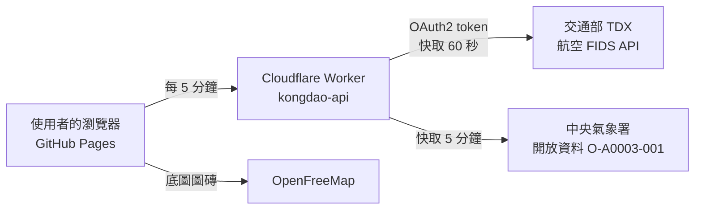

# 空島 ✈ 金門機場即時航班地圖

**線上網站：https://sd9960528-ui.github.io/kongdao/**

把金門尚義機場（KNH）往返台灣各地的航班畫在地圖上，依交通部 TDX 的即時起降資料移動，並結合中央氣象署金門站的能見度觀測，在起霧時提醒使用者。

靈感來自 [軌島 railisland.tw](https://railisland.tw/)：一張會動的台灣鐵道地圖。空島想做的是同樣的事，只是換成金門的天空。

## 功能

- **即時航班地圖**：依 TDX 的實際、預計與表定時間計算飛機位置，取消的班機不畫在地圖上
- **弧線航路與起降加減速**：去程、回程分開，起飛與降落時移動較慢
- **點選飛機**：顯示班號、航空公司、起訖時間、飛行進度與剩餘時間，並畫出已飛／未飛的軌跡
- **出發／抵達看板**：延誤時顯示新時間並劃掉表定時間，打開時自動捲到現在時刻
- **今日統計**：今日班次、空中、已完成、延誤、取消
- **金門天氣與起霧警示**：能見度不佳時地圖上方出現警示，並可開啟瀏覽器通知
- **暗色霓虹主題**：一鍵切換，記住使用者的選擇
- **手機版與 PWA**：可加到主畫面，像 App 一樣全螢幕使用
- **誠實的資料狀態**：拿不到即時資料時明確標示「資料停在幾點」，不以假資料頂替

## 系統架構

- **前端**：純 HTML / CSS / JavaScript，地圖使用 MapLibre GL JS，部署在 GitHub Pages
- **後端**：Cloudflare Workers，負責
  - 保管 TDX 與氣象署的金鑰，不暴露在前端程式碼
  - 快取資料，讓 TDX 的呼叫次數不隨訪客人數增加
  - 被 TDX 限流時暫停重試，並在上游出錯時回傳最近一次的資料
  - 只允許空島的網站使用（CORS）

## 技術重點

| 問題 | 做法 |
|---|---|
| 飛機位置怎麼算 | 以起飛時間與飛行時間算出進度，沿二次貝茲曲線內插，再套用緩動函數模擬起降加減速 |
| 經緯度變形 | 在北緯 24 度附近，經度乘上 cos(24°) 修正，弧線和機頭方向才不會歪 |
| 金鑰安全 | 金鑰存在 Cloudflare Worker 的 Secret，前端只呼叫自己的 Worker |
| API 限流 | 通行證與資料都做快取；遇到 HTTP 429 先停 60 秒，避免越重試越嚴重 |
| 各資料源「沒有資料」的表示法不同 | TDX 欄位缺漏、氣象署用 -990，分別處理後才顯示 |
| 換底圖時自訂圖層消失 | 使用 `transformStyle` 把自己的資料與圖層搬到新底圖，飛機圖示用 `styleimagemissing` 補回 |
| 班號互相重疊 | 使用 MapLibre 的碰撞偵測與 `text-variable-anchor`，放不下的班號放大地圖後才顯示 |

## 資料來源

- 航班：交通部 [TDX 運輸資料流通服務](https://tdx.transportdata.tw/)（航空 FIDS），依政府資料開放授權條款使用
- 天氣：[交通部中央氣象署開放資料平臺](https://opendata.cwa.gov.tw/)，金門站（467110）現在天氣觀測
- 底圖：[OpenFreeMap](https://openfreemap.org/)、© OpenMapTiles、© OpenStreetMap 貢獻者

本站為個人學習專題，與航空公司及金門航空站無關。實際起降時間請以航空公司公告為準；能見度警示的門檻為參考值，並非機場官方起降標準。

## 自己架一份

1. Fork 這個專案，在 Settings → Pages 開啟 GitHub Pages
2. 到 [TDX](https://tdx.transportdata.tw/) 與 [氣象署開放資料平臺](https://opendata.cwa.gov.tw/) 申請金鑰
3. 在 Cloudflare 建立一個 Worker，貼上 `worker.js`，並在 Settings → Variables and Secrets 新增三個 Secret：
   `TDX_CLIENT_ID`、`TDX_CLIENT_SECRET`、`CWA_API_KEY`
4. 把 `worker.js` 裡的 `ALLOWED_ORIGINS` 改成你的網址，`app.js` 裡的 `API_URL` 改成你的 Worker 網址

## 未來規劃

- [ ] 看板顯示登機門與航空公司原始狀態
- [ ] 以 ADS-B 資料顯示飛機真實位置
- [ ] 空島關閉時也能收到起霧推播
- [ ] 時光機：回放今天的航班
- [ ] 累積歷史資料，計算各班次的準點率

## 作者

官昱帆 Ven｜國立金門大學 電機工程學系